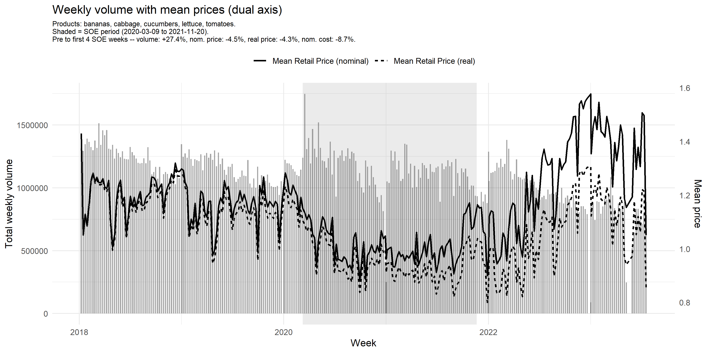
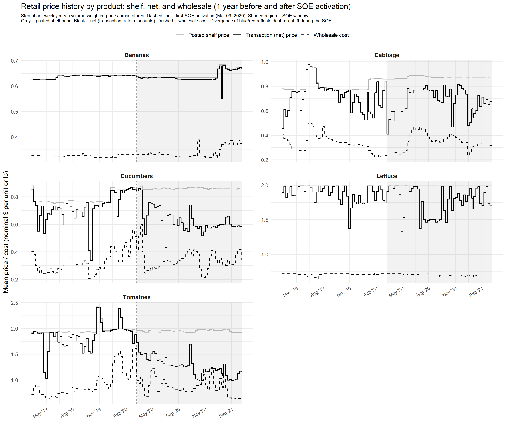
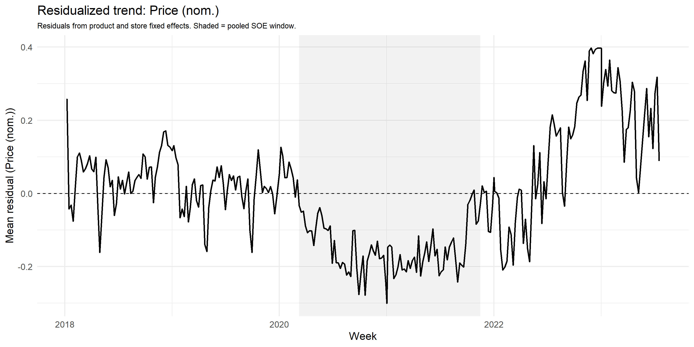
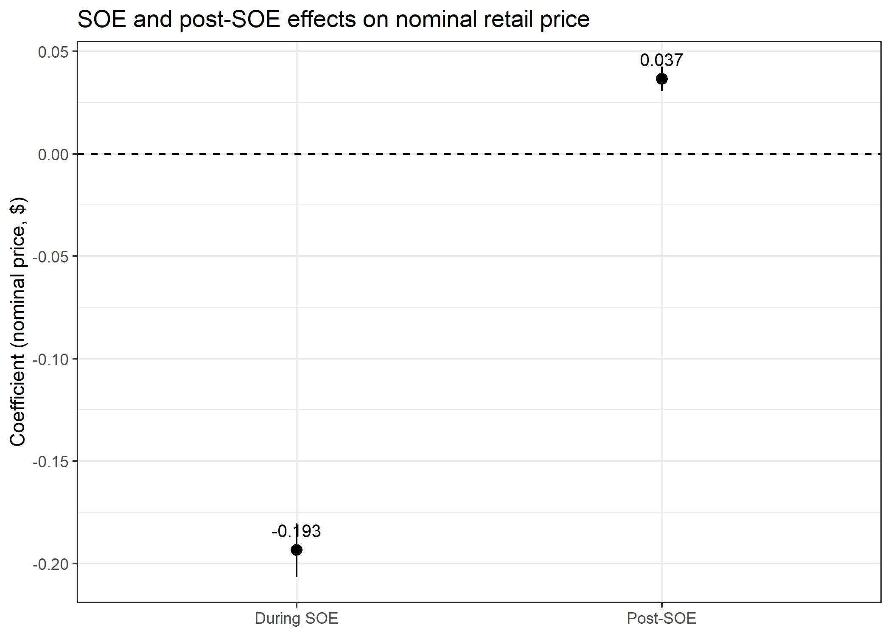
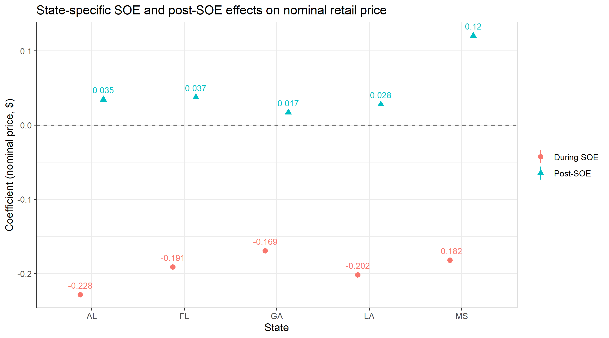
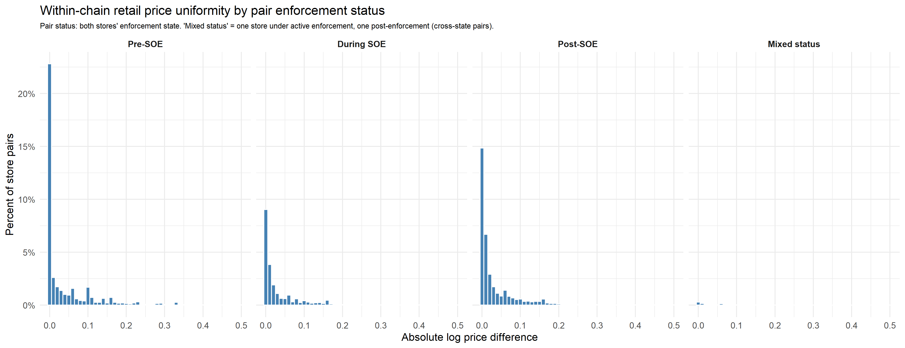
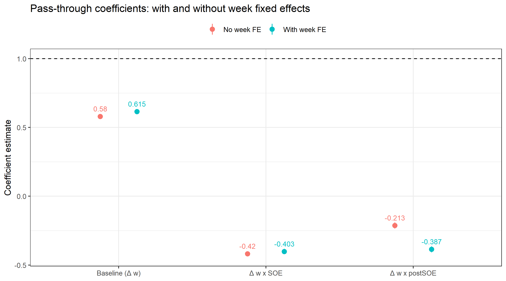
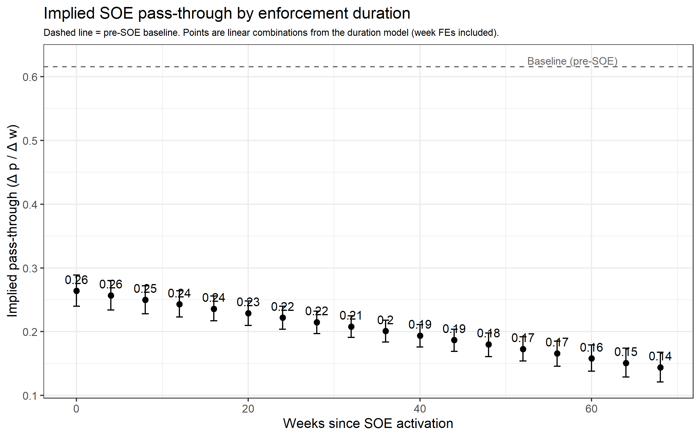
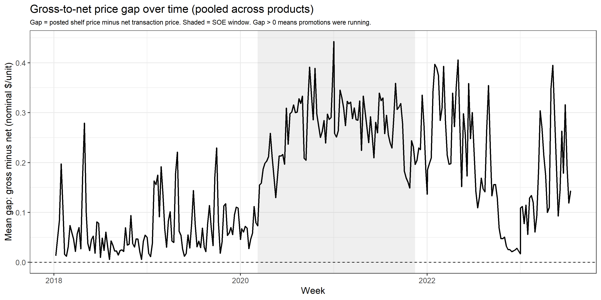

# Food Retailer Pricing Behavior Under Anti-Price Gouging Laws: Evidence from Wholesale and Retail Scanner Data

**Chenarides, Richards, and Dong**

Replication code for the analysis of anti-price gouging (APG) laws and grocery retail pricing during COVID-19 state-of-emergency (SOE) periods. The analysis uses a store-product-week panel of scanner data for five fresh-produce items across five Southeastern states, linking retail transaction prices, posted shelf prices, promotional activity, quantities, and wholesale acquisition costs within the same point-of-sale system.

---

## Quick Start

Before running, three things must be in place:

1. **SQL build.** Run `code/sql/BuildMarkupsNew_2026_04.sql`, then `code/sql/BuildMarkupsNew_PromoExpansion.sql`, in SQL Server (see [SQL Tables](#sql-tables)).
2. **CPI file.** `cpi/cpi_20152025.xlsx` (BLS CPI-U, 1982–84 = 100). Git-ignored; add it locally.
3. **`code/config.R`.** Git-ignored because it is user-specific. It must define `open_decadata_connection()` (a trusted connection to the DecaData SQL Server) and the global flags listed under [Global flags](#global-flags-codeconfigr).

Then open `pg_project.Rproj` in RStudio (sets the working directory automatically) and run:

```r
source("code/run_all.R")
```

All tables and figures are written to `tables_latex/` and `figures/`. See [Script Guide](#script-guide) below for what each script produces.

---

## Data Overview
 
[DecaData](https://decadata.io/) is a proprietary point-of-sale (POS) transaction dataset product from DecaData.io. Records are item-level retail transactions linked to loyalty cardholders, which allows the same underlying data to support both store-level aggregate analysis (prices, volumes, margins by store-product-week) and shopper-level analysis (purchase histories by individual loyalty cardholder). Coverage spans multiple retail chains and banners across a range of U.S. geographies, with data extracts typically licensed for a defined set of retailers, states, and time periods. Item-level fields include both packaged goods (identified by UPC/SKU) and random-weight products (identified by PLU), along with associated wholesale cost and inventory data.
 
### Core variables
 
For each store-product-week observation, DecaData supports construction of:
 
- **Net price** (`p_ist`): volume-weighted actual transaction price (total net sales / total volume). Reflects the sale price when a product is purchased on promotion, and the regular shelf price otherwise. This is the primary retail price outcome used in the analysis.
- **Gross price** (`p_ist_gross`): volume-weighted posted shelf price (total posted shelf revenue / total volume). Does not reflect promotional discounts.
- **Wholesale cost** (`w_ist`): volume-weighted unit cost (total cost / total volume).
- **Dollar margin** (`margin_nom`): `p_ist - w_ist`.
- **Volume**: total units sold.

Transaction-level fields available prior to aggregation include retail price, sale price (if applicable), wholesale cost, units sold or item weight, back-of-store inventory, and case shipments received.
 
### Data structure
 
Raw DecaData tables are staged into an analysis-ready panel through a sequence of SQL views/tables. The final table is a store-product-week panel used in the main regressions. Two additional data frames are constructed separately for shopper-level and transaction-level analyses (loyalty-card-product-week and transaction-level panels, respectively).
 
### Access and documentation
 
An interactive entity-relationship schema for DecaData is available at [dbdocs.io/decadata](<https://dbdocs.io/Lauren%20Chenarides/decadata?view=relationships>). Data access requires a DecaData.io license; the underlying transaction data cannot be redistributed.
 
### Known limitations
 
- The sample covers three grocery chains in five Southeastern states; results should not be interpreted as representative of all grocery retailers.
- Wholesale cost data capture one input cost (procurement cost) and do not include labor, logistics, or other operating costs, which are not separately observed.
- Store coverage is not constant across the sample period; store attrition (concentrated in two banners across two years) affects panel balance in some specifications.
 
---

## Empirical Setting

**Products:** bananas (PLU 4011), cabbage (PLU 4069), cucumbers (PLU 4062), lettuce (UPC 7143001065), tomatoes (PLU 4087)

**States:** Alabama, Florida, Georgia, Louisiana, Mississippi

**Retailers:** three grocery chains: Retailer 2 (national; all five states), Retailer 3 (regional; Florida and Georgia), Retailer 5 (local; Florida)

**Period:** January 2018 – July 2023 (weekly)

**SOE window:** activated March 9–14, 2020 in all five states; expired between March 2021 (Louisiana, 53 weeks) and November 2021 (Mississippi, 88 weeks)

The figure below shows weekly retail volume and prices across all products and stores. The shaded region marks the pooled SOE window.



---

## Variable Construction

The primary retail price is `p_ist_net` — the volume-weighted transaction price (net of promotional discounts). This is the consumer-relevant price and matches the paper's estimating equations. The posted shelf price `p_ist_gross` is retained for robustness and for the promotional expansion mechanism.

Net and gross prices diverge during the SOE because the share of transactions completed at a promotional price rose by about 45 percentage points during the SOE (`tables_latex/22_tab_promo_intensity.tex`). The figure below shows the gross price (grey), net price (black), and wholesale cost (dashed) for each product in the year before and after SOE activation.



**Key variables:**

| Variable | Description |
|----------|-------------|
| `p_ist` | Primary retail price (`p_ist_net`: volume-weighted transaction price) |
| `p_ist_gross` | Volume-weighted posted shelf price |
| `p_ist_net` | Volume-weighted net price (after promotional discounts) |
| `w_ist` | Volume-weighted wholesale unit cost |
| `margin_nom` | Nominal dollar margin = `p_ist` − `w_ist` |
| `SoE` | 1 if APG enforcement active in state s, week t |
| `postSoE` | 1 for weeks after SOE deactivation |
| `Dur_st` | Weeks since SOE activation (0 outside SOE) |
| `k_start` | Event time relative to SOE start |
| `share_on_sale` | Fraction of transactions at a promotional price |

**Subscripts:** i = store, j = product, s = state, t = week

---

## Descriptive Evidence

The residualized price trend below removes product and store fixed effects and plots the weekly mean residual. The SOE window is shaded.



Period means for price, cost, margin, and volume by product are in `tables_latex/04_tab_period_means_nominal.tex`.

---

## Empirical Model and Results

### Price and Margin Level Regressions

Specification:

```
P_ist = α + β₁·SOE_st + β₂·postSOE_st + γ_j + δ_i + ε_ist
```

Fixed effects: product (γ_j) and store (δ_i). Clustering: **state level** (G = 5), supplemented by wild cluster bootstrap inference (Webb weights, B = 9,999). The Mechanism 2 pass-through regressions cluster at the store level.



State heterogeneity in price effects:



---

## Mechanisms

### Mechanism 1: Constant Retail Prices

Within-chain price uniformity is measured as the mean absolute log price difference across store pairs, by retailer-product-week. The regression tests whether uniformity changed during and after the SOE.



### Mechanism 2: Variation in Pass-Through

Specification:

```
ΔP_ist = α + β₁·Δw_ist + β₂·(Δw_ist × SOE_st) + β₃·(Δw_ist × postSOE_st)
         + γ_j + δ_i + τ_t + ε_ist
```

The preferred specification includes week fixed effects (τ_t). The identifying variation — Δw × SOE — varies across stores within a week and is not absorbed by week FEs.



The duration extension asks how many weeks it takes for pass-through to return to baseline after SOE activation:



IV pass-through using distance-weighted cross-market costs is in `tables_latex/12c_tab_iv_passthrough.tex` (produced by `07_passthrough.R` when `RUN_IV = TRUE`).

### Mechanism 3: Countercyclical Pricing

Retailers use promotional discounts to price discriminate between price-elastic shoppers (deal hunters) and price-inelastic shoppers (who pay the shelf price). If APG laws constrain posted prices, retailers may adjust deal frequency or depth as an alternative margin-management channel.

The gross-to-net price gap — the average per-unit promotional discount — widens during the SOE if deal activity increased:



Promotional intensity (share on sale and discount depth) regressions are in `tables_latex/22_tab_promo_intensity.tex`. The extensive/intensive decomposition of the quantity increase (ln Q = ln N + ln(Q/N)) is in `tables_latex/23_tab_extensive_intensive.tex`. The data contain no within-store-day price variation (on a given day, all shoppers at a store pay the same price), so promotional price discrimination operates across weeks rather than through simultaneous price menus.

### Demand Elasticity, Curvature, and Inventory

`09_elasticities.R` estimates the price elasticity of demand before, during, and after the SOE, adds a curvature term, and converts it into the Weyl and Fabinger (2013) inverse elasticity of marginal surplus and an implied pass-through rate for each period. `10_inventory_bottleneck.R` uses store-day inventory on hand for cabbage, cucumbers, and lettuce (2019–2021) to test whether inventory rose relative to sales during the SOE and whether inventory gluts preceded promotions. Bananas and tomatoes have no inventory records, and no inventory table extends past December 2021. These analyses are not yet in the manuscript.

---

## Script Guide

Scripts are called in order by `run_all.R`. The table below maps each script to the paper section it serves.

| Script | Paper section | Purpose | Key outputs |
|--------|--------------|---------|-------------|
| `00_read_in_data.R` | — | Pull product tables from SQL; assemble `panel_upc_week` | `panel_upc_week` in memory |
| `01_price_sensitivity_diagnostic.R` | Variable Construction (diagnostic) | Compare `p_ist_net` vs `p_ist_gross`; step charts by product | `diag_01`–`diag_08` figures |
| `02_build_panel.R` | Variable Construction | CPI deflation, SOE timing, first differences, trimming | `panel_est`, `save_tex()` |
| `03_descriptive_tables.R` | Results: Descriptive Evidence; Incidence of Price Gouging | Coverage tables, period means, flagged-weeks | Tables 01–07, Figs 01–03 |
| `04_residual_plots.R` | Results: Descriptive Evidence | Residualized trend plots by pool/state/product | Figs 04–07 |
| `05_regressions.R` | Empirical Model; Results: Retail Prices; Markups | Price, margin, and cost level regressions; wild cluster bootstrap; robustness (excluding bananas, capped post-SOE windows, event study, leave-one-state-out) | Tables 08–11 (incl. 08b, 08c, 08d, 09b, 10b–10e, 11b), Figs 08–11, 08b |
| `06_uniform_pricing.R` | Mechanisms: Mechanism 1 (Constant Retail Prices) | Within-chain price uniformity; minimum detectable effect for the mixed-status coefficient | Tables 15–20 (incl. 17b–17d, 18b–18c), Figs 14–18 |
| `07_passthrough.R` | Mechanisms: Mechanism 2 (Variation in Pass-Through) | Pass-through regressions, IV, duration extension, logs, robustness | Tables 12–14 (incl. 12b–12d), Figs 12–13 |
| `08_promotional_expansion.R` | Mechanisms: Mechanism 3 (Countercyclical Pricing) | Promo intensity, extensive/intensive margins, category robustness | Tables 21–26, Figs 19–21 |
| `09_elasticities.R` | Demand elasticity and curvature (not yet in manuscript) | Period and state elasticities; curvature and implied pass-through | Tables 27–29 (incl. 27b, 28b), Fig 22 |
| `10_inventory_bottleneck.R` | Inventory and supply side (not yet in manuscript) | Inventory coverage check, weeks of supply, inventory and promotions, shrink bound | Tables 30–33, Figs 23–24, coverage CSVs in `tables_csv/` |

### Global flags (`code/config.R`)

| Flag | Default | Effect |
|------|---------|--------|
| `SAVE_OPTIONAL_PLOTS` | `TRUE` | By-state and by-product residual trend plots |
| `RETAILERS_KEEP` | `c(2, 3, 5)` | Retailers included in the analysis sample (the three chains studied: Retailer 2, 3, 5) |
| `RUN_DUR_EXTENSION` | `TRUE` | Pass-through duration extension |
| `RUN_IV` | `TRUE` | IV pass-through |
| `SAVE_CSV` | `FALSE` | Also write intermediate CSVs alongside LaTeX tables |
| `RUN_INVENTORY` | `TRUE` | Run `10_inventory_bottleneck.R` (defaults in `run_all.R` if not set in `config.R`) |

### Script-level settings

Each script sets a default if the variable is not already defined, so any of these can be overridden in `config.R`.

| Setting | Script | Default | Effect |
|---------|--------|---------|--------|
| `UNIF_WEIGHT_BY_PAIRS` | `06` | `FALSE` | Weight uniformity cells by number of store pairs |
| `PT_NONPROMO_MAX_SHARE` | `07` | `0` | Maximum promotion share for a week to count as non-promotional |
| `PT_NONPROMO_PRODUCTS` | `07` | `c("bananas", "lettuce")` | Products used for the non-promotional-weeks pass-through check |
| `USE_EXACT_OCCASIONS` | `08` | `TRUE` | Use distinct-basket counts (`stg.pd_ext_int_week`) for the extensive margin |
| `ELAS_CLUSTER` | `09` | `~ store_id` | Clustering for the elasticity regressions |
| `ELAS_USE_HAUSMAN_IV` | `09` | `TRUE` | Estimate the within-chain out-of-state price IV |
| `INV_USE_CACHE` | `10` | `TRUE` | Reuse the inventory pull cached in `data/` |
| `RUN_INV_DIAGNOSTICS` | `10` | `TRUE` | Pull item-universe counts by month (full scan of the window) |
| `INV_MIN_COVERAGE` | `10` | `0.5` | Coverage threshold, as a share of pre-SOE coverage, for truncating the window |
| `INV_IGNORE_COVERAGE_DROP` | `10` | `FALSE` | Use the full window even after a sustained coverage drop |
| `SHRINK_BASE_RATES` | `10` | `c(0.05, 0.10, 0.15)` | Assumed pre-SOE shrink rates for the shrink bound |

---

## Output Inventory

### Tables (`tables_latex/`)

| File | Section | Content |
|------|---------|---------|
| `00_tab_summary_stats.tex` | Results: Summary Table | Full sample |
| `01_tab_decadata_summary.tex` | Results: Descriptive Evidence | Coverage by year |
| `02_tab_decadata_summary_wide.tex` | Results: Descriptive Evidence | Coverage by year × retailer × state |
| `03_tab_product_coverage.tex` | Results: Descriptive Evidence | Coverage and sales by product |
| `04_tab_period_means_nominal.tex` | Results: Descriptive Evidence | Period means: nominal price, cost, margin, volume |
| `05_tab_period_means_real.tex` | Results: Descriptive Evidence | Period means: real prices (supplementary) |
| `06_tab_flagged_weeks_all.tex` | Results: Incidence of Price Gouging | APG flag rates across thresholds |
| `07_tab_flagged_weeks_T25.tex` | Results: Incidence of Price Gouging | Flag rates at 25% threshold by product |
| `08_tab_price_reg.tex` | Results: Retail Prices | Price level regressions |
| `08b_tab_price_wcb.tex` | Results: Retail Prices | Wild cluster bootstrap inference, price |
| `08c_tab_price_robust.tex` | Results: Retail Prices | Price robustness: excluding bananas, post-SOE capped at 26 and 52 weeks |
| `08d_tab_loso_jackknife.tex` | Results: Retail Prices; Markups | Leave-one-state-out price and margin estimates |
| `09_tab_price_reg_state_heterog.tex` | Results: Retail Prices | Price effects by state |
| `09b_tab_price_state_heterog_capped.tex` | Results: Retail Prices | Price effects by state with capped post-SOE windows |
| `10_tab_margin_reg.tex` | Results: Markups | Margin level regressions |
| `10b_tab_margin_wcb.tex` | Results: Markups | Wild cluster bootstrap inference, margin |
| `10c_tab_cost_reg.tex` | Results: Markups (accounting check) | Wholesale cost level regressions |
| `10d_tab_cost_reg_state_heterog.tex` | Results: Markups (accounting check) | Wholesale cost effects by state |
| `10e_tab_margin_robust.tex` | Results: Markups | Margin robustness: excluding bananas, post-SOE capped at 26 and 52 weeks |
| `11_tab_margin_reg_state_heterog.tex` | Results: Markups | Margin effects by state |
| `11b_tab_margin_state_heterog_capped.tex` | Results: Markups | Margin effects by state with capped post-SOE windows |
| `12_tab_passthrough_reg.tex` | Mechanisms: Mechanism 2 (Variation in Pass-Through) | Pass-through: no week FE vs week FE |
| `12b_tab_passthrough_log.tex` | Mechanism 2 | Pass-through in logs (robustness) |
| `12c_tab_iv_passthrough.tex` | Mechanism 2 | IV pass-through: OLS vs. distance-weighted cross-state cost IV |
| `12d_tab_passthrough_robust.tex` | Mechanism 2 | Pass-through: shelf price, non-promotional weeks (bananas and lettuce), excluding bananas, capped post-SOE windows |
| `13_tab_passthrough_duration.tex` | Mechanisms: Mechanism 2 (Variation in Pass-Through) | Pass-through duration extension |
| `14_tab_passthrough_implied_soe.tex` | Mechanisms: Mechanism 2 (Variation in Pass-Through) | Implied SOE pass-through at selected durations |
| `15_tab_uniformity_summary_retail.tex` | Mechanisms: Mechanism 1 (Constant Retail Prices) | Retail log-diff summary by period |
| `16_tab_uniformity_summary_wholesale.tex` | Mechanisms: Mechanism 1 (Constant Retail Prices) | Wholesale log-diff summary by period |
| `17_tab_uniformity_retail_main.tex`, `17b_..._robust.tex`, `17c_..._crossstate.tex` | Mechanism 1 | Retail uniformity: main, month-FE robustness, cross-state control |
| `17d_tab_mixed_mde.tex` | Mechanism 1 | Minimum detectable effect for the mixed-status coefficient |
| `18_tab_uniformity_wholesale_main.tex`, `18b_..._robust.tex`, `18c_..._crossstate.tex` | Mechanism 1 | Wholesale uniformity: main, robustness, cross-state control |
| `19_tab_uniformity_heterog_retail.tex` | Mechanism 1 | Retailer heterogeneity: retail uniformity |
| `20_tab_uniformity_heterog_wholesale.tex` | Mechanism 1 | Retailer heterogeneity: wholesale uniformity |
| `21_tab_gross_price_stability.tex` | Mechanism 3 | Posted shelf (gross) price vs. net transaction price |
| `22_tab_promo_intensity.tex` | Mechanism 3 | SOE effect on share on sale and discount depth |
| `23_tab_extensive_intensive.tex` | Mechanism 3 | Extensive vs. intensive decomposition of the quantity increase (ln Q = ln N + ln(Q/N)) |
| `24_tab_gross_net_gap.tex` | Mechanism 3 | SOE effect on gross-to-net price gap |
| `25_tab_category_price_promo.tex` | Mechanism 3 | Category-level robustness: gross/net price and share on sale |
| `26_tab_category_decomp.tex` | Mechanism 3 | Category-level robustness: extensive vs. intensive decomposition |
| `27_tab_elasticity_period.tex` | Demand elasticity | Elasticity regressions: OLS, own-cost IV, out-of-state price IV, product × week FE |
| `27b_tab_elasticity_by_period.tex` | Demand elasticity | Implied elasticity by period (pre, SOE, post) |
| `28_tab_elasticity_curvature.tex` | Demand elasticity | Curvature regressions (quadratic in log price) |
| `28b_tab_curvature_implied.tex` | Demand elasticity | Elasticity, 1/ε_ms, and implied pass-through by period |
| `29_tab_elasticity_state.tex` | Demand elasticity | State-specific elasticities by period |
| `30_tab_inventory_coverage.tex` | Inventory | Inventory coverage of the focal items by year |
| `31_tab_inventory_soe.tex` | Inventory | SOE effects on log inventory, log volume, and log weeks of supply |
| `32_tab_inventory_promo.tex` | Inventory | Lagged weeks of supply and share on sale |
| `33_tab_shrink_bound.tex` | Inventory | Back-of-envelope shrink bound under assumed shrink rates |


### Figures (`figures/`)

| File | Section | Content |
|------|---------|---------|
| `diag_06_cost_series.png` | Variable Construction (diagnostic) | Gross price, net price, wholesale cost over time |
| `diag_08_price_step_by_product_with_cost.png` | Variable Construction (diagnostic) | Step chart: gross, net, wholesale by product ±1 yr around SOE |
| `01_fig_volume_and_prices_dual_axis.png` | Results: Descriptive Evidence | Weekly volume + nominal and real prices |
| `02_fig_cost_weekly.png` | Results: Descriptive Evidence | Mean wholesale cost over time |
| `03_fig_flag_cluster_stacked.png` | Results: Incidence of Price Gouging | APG flag rates: stacked bar |
| `04_fig_resid_volume_pooled.png` | Results: Descriptive Evidence | Residualized volume trend |
| `05_fig_resid_price_pooled.png` | Results: Descriptive Evidence | Residualized nominal price trend |
| `06_fig_resid_cost_pooled.png` | Results: Descriptive Evidence | Residualized cost trend |
| `07_fig_resid_margin_pooled.png` | Results: Descriptive Evidence | Residualized margin trend |
| `08_fig_price_coef_baseline.png` | Results: Retail Prices | Price regression coefficients |
| `08b_fig_price_event_study.png` | Results: Retail Prices | Event study: price around SOE activation |
| `09_fig_price_coef_state_heterog.png` | Results: Retail Prices | Price coefficients by state |
| `10_fig_margin_coef_prepost.png` | Results: Markups | Margin regression coefficients |
| `11_fig_margin_coef_state_heterog.png` | Results: Markups | Margin coefficients by state |
| `12_fig_passthrough_coef.png` | Mechanisms: Mechanism 2 (Variation in Pass-Through) | Pass-through: no FE vs week FE |
| `13_fig_passthrough_duration.png` | Mechanisms: Mechanism 2 (Variation in Pass-Through) | Implied SOE pass-through by duration |
| `14_fig_logdiff_retail_pooled.png` | Mechanisms: Mechanism 1 (Constant Retail Prices) | Retail log-diff distribution |
| `15_fig_logdiff_wholesale_pooled.png` | Mechanisms: Mechanism 1 (Constant Retail Prices) | Wholesale log-diff distribution |
| `16_fig_logdiff_retail_by_period.png` | Mechanisms: Mechanism 1 (Constant Retail Prices) | Retail log-diff by SOE period |
| `17_fig_logdiff_wholesale_by_period.png` | Mechanisms: Mechanism 1 (Constant Retail Prices) | Wholesale log-diff by SOE period |
| `18_fig_uniformity_heterog_coef.png` | Mechanisms: Mechanism 1 (Constant Retail Prices) | Retailer heterogeneity in uniformity |
| `19_fig_gross_net_gap.png` | Mechanisms: Mechanism 3 (Countercyclical Pricing) | Gross-to-net price gap over time |
| `20_fig_promo_intensity.png` | Mechanisms: Mechanism 3 (Countercyclical Pricing) | Share on sale and discount depth over time |
| `21_fig_extensive_intensive.png` | Mechanisms: Mechanism 3 (Countercyclical Pricing) | SOE quantity rise decomposed into extensive/intensive margins |
| `22_fig_elasticity_period.png` | Demand elasticity | Elasticity by period across specifications |
| `23_fig_inventory_coverage.png` | Inventory | Inventory coverage of the focal items by month |
| `24_fig_weeks_of_supply.png` | Inventory | Weeks of supply over time |

### `figures/` vs `figures_repo/`

The analysis scripts write **all** generated figures to `figures/`, which is
git-ignored (see `.gitignore`) because the full set is too large to track on
GitHub. `figures_repo/` holds **GitHub-facing duplicates of only the figures
embedded in this README** and is tracked in git. The README image links point to
`figures_repo/…`. When a README-referenced figure is regenerated, copy the new
version from `figures/` into `figures_repo/` (same filename) so the tracked copy
stays current. `figures_repo/` currently contains the eight `NN_fig_*` panels and
`diag_08_price_step_by_product_with_cost.png` shown above.

---

## Repository Structure

```
price_gouging/
├── code/
│   ├── run_all.R                              # Master script
│   ├── config.R                               # Connection and global flags (git-ignored)
│   ├── 00_read_in_data.R                      # SQL pull
│   ├── 01_price_sensitivity_diagnostic.R      # Price measure diagnostics
│   ├── 02_build_panel.R                       # Panel construction
│   ├── 03_descriptive_tables.R                # Descriptive tables, incidence of price gouging
│   ├── 04_residual_plots.R                    # Residualized trend plots
│   ├── 05_regressions.R                       # Results: prices, margins, cost
│   ├── 06_uniform_pricing.R                   # Mechanism 1
│   ├── 07_passthrough.R                       # Mechanism 2
│   ├── 08_promotional_expansion.R             # Mechanism 3
│   ├── 09_elasticities.R                      # Demand elasticity and curvature
│   ├── 10_inventory_bottleneck.R              # Inventory and supply side
│   ├── apg_analysis.R                         # Deprecated monolithic script
│   ├── SCRIPT_SEQUENCE.md                     # Detailed script notes
│   └── sql/
│       ├── BuildMarkupsNew_2026_04.sql        # Builds stg.store_upc_week and pos_* tables
│       └── BuildMarkupsNew_PromoExpansion.sql # Builds stg.pd_* tables for Mechanism 3
├── cpi/
│   ├── cpi_20152025.xlsx                      # BLS CPI-U (git-ignored)
│   └── cpi_rebase.R                           # CPI diagnostic
├── data/                                      # Inventory cache from 10_ (git-ignored)
├── figures/                                   # PNG outputs (git-ignored)
├── figures_repo/                              # Curated PNGs shown in README (tracked)
├── manuscript/                                # LaTeX manuscript (git-ignored)
├── tables_csv/                                # Optional CSV outputs (git-ignored)
├── tables_latex/                              # LaTeX table outputs
└── pg_project.Rproj
```

---

## SQL Tables

`BuildMarkupsNew_2026_04.sql` builds the weekly store-product panel. `BuildMarkupsNew_PromoExpansion.sql` builds the transaction-level promotional pricing panel for Mechanism 3. Run these in SQL Server before sourcing R scripts. `10_inventory_bottleneck.R` reads `stg.combined_inventory` directly with read-only queries and needs no build step.

| SQL table | Content | Used by |
|-----------|---------|---------|
| `stg.pos_bananas_4011` | Bananas (PLU 4011) weekly panel | `00_read_in_data.R` |
| `stg.pos_cabbage` | Cabbage (PLU 4069) weekly panel | `00_read_in_data.R` |
| `stg.pos_cucumbers` | Cucumbers (PLU 4062) weekly panel | `00_read_in_data.R` |
| `stg.pos_lettuce` | Lettuce (UPC 7143001065) weekly panel | `00_read_in_data.R` |
| `stg.pos_tomatoes` | Tomatoes (PLU 4087) weekly panel | `00_read_in_data.R` |
| `stg.date_week_index` | Week sequence to calendar date mapping | `00_read_in_data.R` |
| `stg.pos_store_master` | Store metadata (lat/lon, state) | `00_read_in_data.R` |
| `stg.store_dim` | Store-to-retailer and state mapping (built by `BuildMarkupsNew_2026_04.sql`) | `08_promotional_expansion.R` (category UPC count) |
| `stg.pos_weekly_presence` | Store-UPC-week sales and presence for all UPCs (built by `BuildMarkupsNew_2026_04.sql`) | `08_promotional_expansion.R` (category UPC count) |
| `stg.store_category_week` | Store-category-week rollup over all UPCs in each focal category (built at the end of `BuildMarkupsNew_2026_04.sql`) | `08_promotional_expansion.R` (category robustness) |
| `stg.pd_store_upc_day` | Daily loyalty-card transaction panel (built by BuildMarkupsNew_PromoExpansion.sql; intermediate for weekly rollup) | --- |
| `stg.pd_store_upc_week` | Promotional pricing panel (share on sale, discount depth) by store-UPC-week | `08_promotional_expansion.R` |
| `stg.pd_ext_int_week` | Distinct-basket occasion count | `08_promotional_expansion.R` |
| `stg.combined_inventory` | Store-day inventory on hand (existing table; read only) | `10_inventory_bottleneck.R` |

---

## R Packages

```r
pacman::p_load(
  DBI, odbc, dbplyr,
  dplyr, tidyr, lubridate, stringr, purrr,
  ggplot2, scales,
  fixest, broom,
  knitr, kableExtra,
  readxl, rlang, ggpattern, remotes,
  fwildclusterboot, dqrng, tibble
)
```
